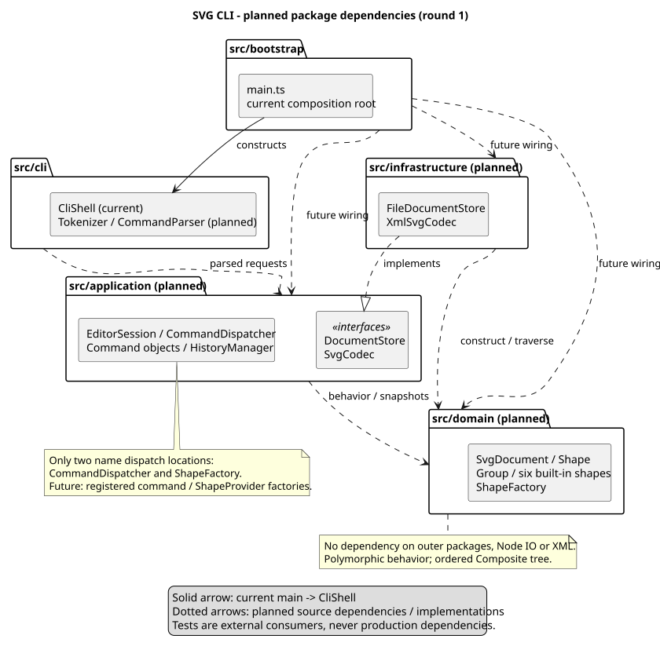

# SVG 编辑器（CLI）个人 Lab：正式提交文档

当前为第四轮。按功能逐步实现、验证和提交的详细记录见 [round4.md](round4.md)；前几轮过程与验证记录保留原始事实。

## 1. 项目信息和运行方式

- 课程：《高级软件开发技术》；作业：Lab1 Phase 1。
- 作业基线：[phase_cli_1.md](../phase_cli_1.md)，保持原文不变。
- Git 仓库地址：[arcflute/svg-editor-cli](https://github.com/arcflute/svg-editor-cli)。本项目独立仓库的 origin 为 `https://github.com/arcflute/svg-editor-cli.git`，目标分支 main。
- 当前进度：第四轮——已实现 `init/create/tree/show/help/move/scale/set/delete/undo/redo`；五个编辑命令统一候选提交，历史保存真实类快照。**group/ungroup/addto/front/back、read/save/canvas、SVG 读写尚未实现**。
- 第一轮独立提交：`c6b5e137ccd1fa8fb760844efb87d17d08660144`；第二轮独立提交：`b930b61cb561aaf07d5154ba84d051b71c66b902`。此前推送受 HTTPS Git 认证阻碍，用户完成认证后已确认两轮均在远程 main 历史中，且本地 main 已跟踪 origin/main。
- 更新日期：2026-10-30（Asia/Shanghai），前三轮发生于 2026-10-26。作者姓名、学号、课程截止时间尚未提供，不代填。
- 本地/远程：2026-10-30 经 GitHub 连接器核实远程 main 为 a3beb43；本机 Git fetch/push 仍报 443 连接失败。用户随后授权第四轮先本地开发、按功能提交，暂缓推送；第三轮 c6f7284 及第四轮提交尚未同步，不声称远程已完成这些功能。
- 实际开发环境：Windows PowerShell；Node.js v22.15.0；npm 10.9.2；Git 2.39.1.windows.1。第一轮结束时身份缺失；开始第二轮前，已按用户提供的署名和邮箱配置项目级 Git 身份，不修改全局配置。

在项目根目录运行（首次安装后即可启动）：

```sh
npm ci
npm run cli
npm run typecheck
npm test
npm run build
node dist/bootstrap/main.js
```

`npm test` 使用 `vitest run`，执行一次退出。CLI 显示 `svg-editor 0.1 — type 'help' for commands` 与 `svg> `，逐行执行十一种已实现命令。help 列出全部作业命令，八个后续命令标为 `[not implemented yet]`；调用时明确报错。空行/整行注释静默跳过；单条错误后继续，错误统一写 stderr 一行一个 `error:`。EOF 正常结束，不新增 exit/quit；自动验证关闭 stdin，未声称人工验证终端按键。

输入示例和 PowerShell UTF-8 回放命令见 [examples/README.md](../examples/README.md)。text 内容整体双引号包裹，支持中文、空格、空串及 `\"`/`\\`；未知转义和相邻引号片段报错，无行尾注释。六种 create 均支持尾部未引用的 `in <containerId>`。完整规则和暂定选择见 [D-07](decisions.md#d-07-第三轮分词和参数边界)。

固定开发依赖为 TypeScript 5.9.3、tsx 4.23.15、Vitest 5.0.5、Vite 8.3.5、@types/node 22.15.3，均通过 npm 安装，锁文件已提交；第三轮未改依赖。版本依据与工具链理由见 [D-01](decisions.md#d-01-工具链与目录)。

## 2. 架构方案

### 2.1 模块划分和职责



图源：[architecture.puml](architecture.puml)；兼容预览：[PNG](architecture.png)。实线为当前装配/调用/测试依赖，虚线为 IO 规划依赖；当前 CLI→application→domain 及历史已接通。采用本地 Java 24.0.1 + PlantUML 1.2026.9 的 Smetana 布局，无需 Graphviz；工具 jar 放在被忽略的 `.tools/`，不作为项目依赖或提交内容。图源遵循 [PlantUML 官方命令行用法](https://plantuml.com/command-line)。

```powershell
java '-Djava.awt.headless=true' -jar .tools/plantuml.jar -charset UTF-8 -tsvg doc/architecture.puml
java '-Djava.awt.headless=true' -jar .tools/plantuml.jar -charset UTF-8 -tpng doc/architecture.puml
```

上述为本机重现命令，克隆仓库后需自行提供 PlantUML jar；运行 CLI 和测试不依赖 Java/PlantUML。

| 模块/目录 | 职责及计划中的类/接口 | 当前状态 |
|---|---|---|
| src/domain/ | Shape、六种具体类型、SvgDocument、ShapeFactory；TreeNode/GeometricShape/Geometry/Validation/DomainError；中立 ShapeStyle/ShapeDescription/ShapeTypeDescription 契约 | 14 个行为类；第三轮增加多态展示描述和工厂参数元数据，保持既有树/克隆 API |
| src/application/ | Command/EditCommand，十一种具体命令；CommandDispatcher/ArgumentParser/EditorSession/TextPresenter/InputError；HistoryEntry/HistoryManager 与只读状态/查询接口 | 编辑与历史已实现；DocumentStore/SvgCodec 接口仍规划 |
| src/cli/ | CliShell 的 readline 输入输出和统一错误前缀；Tokenizer 扫描并保留引号来源 | 已接通应用层；命令参数解析放到各 Command.parse，不再另建 CommandParser |
| src/infrastructure/ | FileDocumentStore、XmlSvgCodec 实现接口；文件和 XML 库细节 | 仅规划，不提前选 XML 库 |
| src/bootstrap/ | main.ts 共享工厂装配会话、分发器和终端流 | 现有装配不变，历史由会话维护；以后再加 IO 适配器 |
| tests/ | 领域回归、分词/参数、编辑与历史事务、故障注入、CLI 真实进程及样例回放 | 14 个文件共 292 项，原领域与启动验证目的保留 |
| examples/ | §6.1 版本 A 的创建/查询及编辑/历史脚本 | round3/round4.commands.txt 可执行；尚无 SVG 文件 |
| doc/ | 正式文档、需求矩阵、决策与架构图 | 同步第四轮范围与证据；分组/IO 相关完整历史场景仍待验证 |

与建议目录的唯一区别是暂不创建无代码目录；职责边界不变。所有已实现类独占同名文件；main.ts 是装配入口，不人为创建没有行为的 Main 类。结构/几何辅助类均实际被模型使用，不是占位框架。

### 2.2 设计模式选择与计划落地位置

**Command（已落实十一种命令）**：Command 定义 execute(session)，各类保存意图与参数；五个编辑类 Create/Move/Scale/Set/DeleteCommand 继承 EditCommand，共用会话事务，apply 只接受候选文档。Undo/RedoCommand 交给会话准备历史迁移。InitCommand 建文档边界，Tree/Show/HelpCommand 查询；没有空的 DocumentCommand/QueryCommand 类。CommandDispatcher 仍为唯一名字分派和 help 目录，参数由各 parse 定义。

**Composite（已落实）**：Shape 统一 move/scale/set/clone 与 attributes；Group 有序持有 Shape 子节点并多态递归，叶子通过 GeometricShape/不可变 Geometry 更新自身字段。SvgDocument 通过 TreeNode 的受保护操作统一维护结构与 ID 索引；外层无容器写数组接口。普通 g 的样式仅保留在自身，未来序列化通过 SVG 继承呈现；本轮不做渲染或 box。

**Factory（已落实创建与参数来源）**：ShapeFactory 的同一个私有静态表同时保存各类型构造函数和中立参数描述；create/describe/descriptions 共用这一入口。ArgumentParser 按描述转换位置参数，help 按描述生成语法；domain 不读取 token。显示使用各具体类多态描述和 TextPresenter，不在外层再 switch(tag)。未来再将两处集中分派改成 bootstrap 装配的命令/ShapeProvider 注册协议；当前不提供动态注册。

实际协作：CliShell → Tokenizer → CommandDispatcher → Command.parse/execute → EditorSession；编辑由 EditCommand.apply 操作领域候选，HistoryEntry 复制前后文档，HistoryManager 准备新两栈，最后一次替换会话 state。查询经 Shape.describe/DocumentView → TextPresenter → CliShell。clone 为 O(N)，历史数组迁移 O(H)，每次编辑/恢复 O(N+H)，历史总存储 O(HN)；适合当前离散 CLI 的课程规模，未做性能基准。

### 2.3 依赖方向规则及理由

| 模块 | 允许的项目依赖 | 禁止/理由 |
|---|---|---|
| domain | 自身纯领域代码 | 不依赖 application/cli/infrastructure/bootstrap，不用 readline、fs、XML 库；模型行为可独立测试 |
| application | domain；自身声明的端口 | 不引用具体 CLI/IO 实现；通过接口替换外部能力并注入故障测试 |
| cli | application；终端标准库 | 不直接依赖 domain 具体类或修改图形字段；只调用用例，保证多通道一致性 |
| infrastructure | application 中的接口、domain；fs/XML 库 | 不依赖 cli/bootstrap；只负责适配及格式，不承包核心几何行为 |
| bootstrap | 以上模块与进程流 | 只负责构造和连接，不放业务规则 |
| tests | 被测模块及测试工具 | 生产代码不能反向依赖 tests |

领域接口保持中立，不泄露 token、终端或 XML 库节点。当前 bootstrap 装配 cli/application/domain；cli 只通过 application 调业务，application 依赖 domain，domain 仅引用自身相对模块。application/domain 均不打印、不导入 Node IO；查询跨层只返回值，不泄露可变文档。未来违反方向即记为待处理项。

### 2.4 变化点假设、预留与不预留

| 变化点 | 预留的设计边界 | 暂不预留的能力与理由 |
|---|---|---|
| 新图形/box/插件 | Shape 多态与集中 ShapeFactory；Composite 有序树 | 无动态插件加载器/box；后续阶段再把集中分派改注册协议 |
| 命令扩展与多通道 | Command 对象、会话与 CLI 分离，统一 ID | 无 GUI、HTTP、路径寻址，当前没有需求 |
| 文件存储或 XML 实现替换 | 应用端口 DocumentStore/SvgCodec | 不提前安装 XML 库或做通用存储插件框架 |
| 历史性能 | HistoryManager 集中事务与快照协议 | 暂不做逆操作日志、持久化、拖拽事件合并，等待真实性能证据 |
| 更广 SVG 支持 | A-03 兼容边界和往返测试计划 | 不先写 transform 矩阵系统或任意 XML 透传 |

### 2.5 第二轮公开领域 API

| API | 当前契约 |
|---|---|
| `new SvgDocument(width = 800, height = 600, roots = [])` | 正有限画布尺寸；批量根构造原子验证后一次建索引；文档根无图形 ID |
| `document.find(id)` / `require(id)` | 返回原实例或 undefined；require 缺失时抛 DomainError；大小写敏感 |
| `document.insert(shape, parentId?, position?)` | 仅接受 detached 子树，省略父级为文档根；完整检查内部/外部重复 ID、父级与下标后挂入 |
| `document.remove(id)` | 返回被移除的原子树；子孙 ID 全部释放，内部父子关系保留，子树根 parent=null |
| `document.reparent(id, parentId?, position?)` | 同文档内重挂接；检查环；position 为移除后的最终位置，默认追加；索引仍指向原实例 |
| `document.resize(width, height)` | 先校验两尺寸再更新；只是领域操作，不等于 canvas 命令/历史屏障 |
| `shape.id/type/parent/children/attributes/style` | ID/父级只读；集合和属性为冻结副本；子元素仍提供行为方法 |
| `shape.move/scale/set` | 多态更新、严格白名单、溢出失败无部分修改；Group 样式不覆写孩子 |
| `shape.clone()` / `document.clone()` | 实际具体类独立副本；保持缺省样式、文本、顺序与新父链接/索引 |
| `ShapeFactory.create(type, id, attributes)` | 中立命名属性，如 rect 使用 width/height，数值已是 number；拒绝 box/未知类型及未知字段 |
| 第三轮 `ShapeFactory.describe(type)` / `descriptions()` | 冻结的参数名、属性映射、种类和可选标记，构造与描述同源 |
| 第三轮 `Shape.describe()` | 冻结的 ID/类型、属性/样式和多态几何展示值，不含模型行为或父对象 |

结构细节与数值选择见 [D-04–D-06](decisions.md)。`Group` 无公开 add/remove 子节点接口，文档树和索引只能通过文档一起维护；单独 Group 构造用于组装 detached 树，不替代应用层 group 命令。

### 2.6 当前应用接口

EditorSession.initialize(width,height) 验证新文档并建立历史屏障。executeEdit(command) 取代第三轮专用 create 方法，统一准备候选、输出、前后快照和新历史后提交。undo/redo 先克隆恢复目标并准备栈迁移，再提交；历史快照不直接成为活跃文档。readTree/readShape 返回深度冻结的纯描述，readHistoryStatus 仅返回冻结的计数/禁用位；没有活动文档/栈 getter。CommandDispatcher.execute(tokens) 返回冻结输出行。文件路径/默认路径尚未进入会话，IO 的原子性仍需后续实现。

## 3. 需求范围与待确认事项

[需求矩阵](requirements.md) 保留 DOM/R3 子项，第四轮增加 R4 子项并更新已验证编辑命令。当前五个编辑命令的撤销单元、快照隔离、redo 清空与 init 屏障已验证；HIS 原项中涉及未来 group/IO/canvas 的完整场景仍待实现，不以当前子集代替全部验收。

四项主要歧义的暂定选择详见 [决策记录 A-01–A-04](decisions.md)：跨父 group 用最近共同祖先和原树顺序；成功文档操作清空两栈并禁用；外部 SVG 对不支持的语义明确拒绝、box 标记按普通 g 降级；成功显式 save 更新后续默认路径。它们均未获教师确认，尤其 transform 支持范围与原文背景示例有待核实。它们不阻塞本轮创建/查询，也不能当作验收标准已获批准。

## 4. 过程记录

以下按轮次保留实际工作，不编造用户确认或人工验收；1–10 为第一轮、11–17 为第二轮与认证同步、18 起为第三轮：

1. 读取全部 phase_cli_1.md，检查工作区及父级可适用 AGENTS.md。初始只有作业文件，无代码、Git 仓库或项目约定。记录原文 SHA-256 为 `D8BBF9409A9596035F13AE809888C64E813EA76966B649911536DA44EABC7F76`，后续复核一致。
2. 核实 Node/npm/Git 版本。默认 PowerShell 配置因 PATH 中 Java 路径引号触发 Conda 初始化错误，改用不加载 profile 的执行会话；未改系统配置。
3. 在当前项目根初始化 main 分支，确认没有误用父级仓库。查询 Git 身份为空，git var GIT_AUTHOR_IDENT 明确失败；无远程，因此暂不提交、不推送。
4. 对照原文细则纠正容易混淆的边界：canvas 查询不禁用历史，box 不属当前阶段，g 为根直接子节点时禁止 ungroup；区分 set 白名单与外部 SVG 兼容范围。
5. 建需求矩阵、五模块架构和命令对象＋快照方案；把跨父 group、历史边界、外部 SVG、保存路径写为假设，未冒充教师确认。
6. 查询 npm 元数据后选定兼容的精确依赖并安装，生成锁文件。创建 strict TS 配置、CliShell 与 bootstrap；没有为目录填充空类，没有实现业务命令。
7. 建真实子进程冒烟测试，覆盖启动/EOF、多行 CRLF、空行、末行没有换行和未实现错误；首次 typecheck、测试和 build 均通过。实际 npm run cli 输入及构建入口也已检查。
8. 本机有 Java 但无可用 PlantUML/Graphviz 命令或现成 jar。下载官方 PlantUML 1.2026.9 至忽略目录，在本地渲染；首次未引用的 `-Djava.awt.headless=true` 被 PowerShell 错误解析，改成单引号参数后成功。查看 PNG 后发现接口标签贴近邻接内容，将其改为标记 interfaces 的组件框，重新渲染复核。没有使用远程服务上传项目图源，也未声称在浏览器预览业务 SVG。
9. 文档检查脚本经 PowerShell 管道传入 Node 时，中文正则因默认编码变为问号；仅为该检查会话设置 UTF-8 输出编码后通过。共检查 73 个唯一需求编号、完整表格列/状态、6 份 Markdown 的本地文件链接目标及锁文件声明一致性；不是业务测试。
10. 将本轮 18 个新文件及未修改的作业基线显式加入暂存区，检查无依赖目录/构建产物/日志/工具 jar。全量 diff --check 发现原始 phase_cli_1.md 文件末尾已有空行提示，遵守不可修改原文要求保留；排除该基线后，本轮新增文件检查通过。7 项本轮成果更新为已验证，其余 66 项保持未实现。因提交身份缺失保留暂存，尚无提交哈希。
11. 第二轮开始前重新只读审查基线，确认 19 个暂存文件和原文哈希未变，锁文件一致。远程 ls-remote 成功且没有引用，确认用户提供的仓库为空。发现 Git 身份仍缺失后未开始第二轮代码；用户提供 arcflute 署名与邮箱后，仅配置本项目身份和 origin，更新仓库信息，准备独立第一轮提交。用户明确授权两轮分别推送，覆盖第一轮“不推送”的限制。
12. 建立第一轮根提交 `c6b5e137ccd1fa8fb760844efb87d17d08660144`，没有混入 domain 文件。实际 `git push -u origin main` 失败：`Cannot prompt because user interactivity has been disabled` / `could not read Username for 'https://github.com': terminal prompts disabled`。只读访问空仓库成功不代表有写权限；通知用户认证缺失后，依其授权继续第二轮本地开发。
13. 实现六种 Shape、工厂与领域异常，使用私有字段、不可变 Geometry 和预计算提交动作。TreeNode 将父链接/有序子节点/归属/ID 索引封装在同一结构实现内，SvgDocument 是独立根，Group 不暴露会绕开索引的孩子写接口。
14. 创建领域测试，覆盖全部六类型、失败输入、有限数溢出、树约束、克隆隔离及作业流程图。第一批 typecheck 与 72 项测试全部通过（含既有 2 项启动测试），没有伪造测试失败后修复的经历。
15. 编写与复核代码过程中发现初稿 clone 对每个根调用 insert 会重复复制索引，Group 构造也重复扫描后代；改成文档一次建索引，以及 Group 验证互异 detached 根，避免宽树/深树上的重复工作。另补尺寸溢出与 line 第二端点溢出测试；最终 74 项测试通过。此修正来自代码复杂度分析，没有声称做过性能基准。
16. 实际运行 typecheck、test、build、开发 CLI 和编译入口，全部通过；CLI 对 init/help 仍明确报未实现。检查 domain import、类名和分派位置后更新领域子需求、决策、架构图及正式文档；未实现分词、命令执行或历史/IO，未做业务 SVG 浏览器预览。
17. 用户回复 GitHub 认证已配置后，重新检查发现远程 main 已指向第二轮提交 `b930b61cb561aaf07d5154ba84d051b71c66b902`。fetch 后核实两轮提交均在远程祖先历史中；执行 `git push -u origin main` 返回 Everything up-to-date，并建立跟踪关系。仅更新文档中的当前同步状态，保留先前真实认证失败记录，不改写两轮提交、不新增业务功能。
18. 第三轮读取用户附件、原文和现有代码/文档；工作区干净，本地 main 与 origin/main 同为 `a3beb436e6f02710da6a986b3799173768551ea0`。fetch 成功、无双方独有提交；基线 typecheck 和 74 项测试通过，未重置或覆盖工作区。
19. 将 ShapeFactory 的集中 switch 改为同一个构造/参数描述表；新增各图形的多态几何展示值。增加逐字符 Tokenizer、五种 Command、唯一分发器、私有 EditorSession 与只读 TextPresenter；CLI/入口接入，未新增依赖或未来命令占位类。
20. 首次类型检查发现按 `parent === document` 判断不能让 TypeScript 排除 SvgDocument，随后读取 type/id 报错。改为检查父级是否具有图形身份（`'id' in parent`），保持无图形 ID 的文档根语义；没有按六种类型再分派。修正后类型检查通过。
21. 保留原领域测试与启动/EOF 验证目的，增加词法、六种参数、失败候选、冻结查询、错误恢复和 60 条快速输入用例。8 个文件共 164 项测试通过。真实样例回放验证八个图形的固定树、子树、文本、样式与父级；没有 move/undo/save 或 SVG 浏览器预览。
22. 构建通过后分别用 npm run cli 和编译入口 stdin 回放样例。临时比对脚本最初搜索宽泛的 svg-editor，误匹配 npm 包名横幅；改成完整启动行定位，并将创建计数限定为图形摘要（排除画布 init）。修正后的核验通过：退出码均 0，stderr 均空，八次图形创建且业务输出一致。
23. 源码 AST 检查确认 27 个类独占同名文件，实际 import 符合依赖方向；分支审查未发现外层图形类型分派。文档统计脚本初次正则漏掉 E2E 两行，修正编号匹配后验证 100 个唯一编号（47 已验证/53 未实现）、完整列/状态及六份 Markdown 的本地文件链接。原文 SHA-256 未变；本地重新渲染架构 SVG/PNG 并查看。
24. 提交前再次 fetch 时遇到 GitHub 443 连接失败（约 21 秒后退出 128）；没有把网络失败当作远程为空，也没有改写历史或更换仓库。此前本轮起始 fetch 成功；最终推送与引用核验以交付回复中的实际结果为准。
25. 2026-10-30，用户询问提交与进度。实际重新 fetch/push 仍连接失败，经 GitHub 连接器确认远程 main 为 a3beb43；说明第三轮仅本地提交、先前按轮次提交粒度偏大。用户随后授权先继续本地开发、推送以后处理。第四轮没有再发起推送。
26. 以 c6f7284 为干净基线，typecheck 和原 164 项测试通过；依次实现移动、缩放、属性修改、子树删除，每项在针对性测试和文档更新后独立提交，分别为 e79c17c、aa92715、5996f20、4fdbf55。没有人为等待或修改提交时间。
27. 为历史把活动文档和 HistoryManager 合为一个 state 引用。HistoryEntry 保存独立的前后快照，恢复时再克隆，规避“恢复后再编辑污染历史”的风险。调整旧候选测试对 clone 次数的固定下标假设，保留其原子性验证目的；没有虚构产品测试失败。详细设计、检查顺序见 round4.md。
28. 全量 typecheck、292 项测试和 build 通过；真实回放 round4.commands.txt 的开发与编译入口，退出 0、stderr 空、业务输出一致。验证移动 node2 不影响连接线、缩放 node1、修改文本/样式和删除后整组恢复。仍未生成 SVG 或做浏览器验收。

## 5. 一致性自查

| 检查 | 规划架构 | 当前骨架实际情况 | 结论/后续 |
|---|---|---|---|
| 模块划分 | 五模块架构 | domain/application/cli/bootstrap 已有代码；infrastructure 仍规划 | 参数 parse 在具体命令内，调整理由见 D-08 |
| 类封装 | 一类一文件、图形多态行为 | 领域状态私有，应用会话私有；命令参数私有；展示与 token 接口为只读值 | 传输描述不是核心模型，领域行为仍由类承担 |
| 模式 | Command/Composite/Factory | 十一种 Command，五个编辑类共享 EditCommand 事务；六图形 Composite、集中 Factory | 历史已接通当前编辑；分组和 IO 仍未实现 |
| 依赖方向 | 内层不依赖外层；bootstrap 装配 | cli→application→domain，domain 无外层/Node IO/XML；应用不打印 | 当前源码审查符合，未安装永久架构守卫 |
| 名字分派 | 命令分发/图形工厂两处 | CommandDispatcher 单目录、ShapeFactory 单构造/描述表；展示调用多态描述 | 属性和数据种类校验不等于图形类型分派；无第二份类型表 |
| 文档与状态 | 每轮同步更新 | 当前编辑及 R4 历史子项已验证；跨 group/IO/canvas 完整场景仍待验收 | 不把领域结构 API 当成 CLI 分组完成 |
| Git/交付 | 分步提交、远程、最终标签 | 第四轮按移动/缩放/属性/删除/历史分别本地提交；第三轮起待推送 | 用户允许暂缓远程同步；不强推、不重写、不打 final |

## 6. 质量保证手段

### 第一轮实际执行（历史记录）

| 检查/命令 | 结果及范围 |
|---|---|
| npm install --save-dev --save-exact（锁定版本见 package.json） | 成功生成 package-lock.json；审计 42 个包，0 个已知漏洞（安装当时的 registry 结果） |
| npm ls --depth=0 | 5 个直接开发依赖均与声明版本一致 |
| npm run typecheck | 退出码 0；strict 检查代码、测试及 Vitest 配置 |
| npm test | 退出码 0；1 个测试文件、2 个真实进程测试通过；自动退出 |
| npm run build | 退出码 0；生成 dist/，不跟踪构建产物 |
| npm run cli（空行后 EOF；另一次输入 init/help 后 EOF） | 均退出码 0；有启动信息/提示符，业务命令明确拒绝 |
| node dist/bootstrap/main.js（空行后 EOF） | 退出码 0；构建结果能独立由 Node 启动 |
| PlantUML 本地 SVG/PNG 渲染 | 首次 Java 参数解析失败，引用参数后成功；标签布局调整后复核 |
| 原文 SHA-256 | 与首次读取一致；未改作业要求 |
| import/类声明审查 | 当前仅一个 CliShell 类、无业务类型分支；依赖符合骨架计划 |
| PlantUML `-checkonly` 与修订后图片查看 | 语法检查退出码 0；SVG/PNG 均已生成，接口标签布局已复核 |
| 文档与锁文件脚本检查 | 73 个唯一需求编号、列/状态完整；6 份 Markdown 无缺失的本地文件链接目标（不含锚点校验）；依赖声明与锁文件根一致 |
| `git diff --cached --check -- . ':(exclude)phase_cli_1.md'` | 通过。本轮文件无空白错误；未排除原文的全量检查仅报告原文末尾空行，原文不修改 |
| git status / diff --cached / ls-files / check-ignore | 19 个暂存文件：18 个新增成果＋原始要求基线；node_modules、dist、.tools 均忽略，没有无关内容 |
| git remote -v / git tag --list / 身份查询 | 无远程、无标签；姓名/邮箱未配置，未创建提交 |

原始要求只作为仓库基线纳入暂存，内容哈希不变。实际图源和文档图片纳入暂存；本地工具 jar 不纳入。上述质量检查表记录第一轮结束时的实际情况。第二轮开始前身份与远程配置已补齐；按新授权分别提交并推送第一轮、第二轮，不重写历史、不强制推送、不打 final 标签。

### 第二轮实际执行

| 检查/命令 | 结果及范围 |
|---|---|
| 第一轮暂存/身份/分支检查 | 19 个文件均属本项目；工作树与暂存一致；身份由用户补充后配置，仅创建第一轮提交 |
| `git ls-remote --symref https://github.com/arcflute/svg-editor-cli.git` | 返回 0、无引用，远程当时为空；不是网络失败推断 |
| `git push -u origin main` | 失败，缺少可用的 HTTPS Git 凭据；未声称同步成功 |
| `npm run typecheck` | 退出码 0，strict 检查源代码/测试/配置 |
| `npm test` | 退出码 0，5 个文件、74 项通过并退出；领域 72 项＋既有启动 2 项 |
| `npm run build` | 退出码 0，生产源代码可编译 |
| `npm run cli` 输入 init/help 后 EOF | 退出码 0，两条均明确报未实现，提示符及退出正常 |
| `node dist/bootstrap/main.js` 空行后 EOF | 退出码 0，编译入口可运行 |
| 原文 SHA-256 | 仍为 `D8BBF9409A9596035F13AE809888C64E813EA76966B649911536DA44EABC7F76` |
| 源码复核 | 领域无外层依赖；每类同名文件；工厂唯一类型名分派；无 JSON 克隆；未修改原 CLI 代码/测试 |
| PlantUML SVG/PNG 渲染、`-checkonly`、PNG 查看 | 本地生成成功，语法检查退出码 0；已查看第二轮图，实际领域/测试与规划模块标识清楚 |
| TypeScript AST 检查脚本 | 14 个领域类均与文件同名且一类一文件；导入仅 ./；仅有工厂类型 switch 和公共属性 switch |
| 文档/锁文件检查脚本 | 6 份 Markdown 本地文件链接目标存在（不含锚点校验）；90 个唯一需求编号、25 已验证/65 未实现，列与状态完整；锁文件一致 |
| Git 最终暂存审查 | 26 个第二轮相关文件，diff --cached --check 通过；node_modules/dist/.tools 忽略；原文、CLI、原启动测试、package 配置/锁文件与第一轮提交无差异 |
| 认证完成后的 ls-remote / fetch / merge-base --is-ancestor | 远程 main 与本地第二轮提交一致，两轮开发提交均为远程 main 的祖先 |
| 认证完成后的 `git push -u origin main` | 退出码 0、Everything up-to-date，已建立 main → origin/main 跟踪；先前失败记录保留为真实过程 |

第二轮开发与验证已经完成，两轮提交均已远程同步。认证完成后的补充工作仅检查 Git 状态、核实远程历史和更新这些文档，没有修改代码或依赖，因此未重复运行已通过的 74 项测试。文档同步另作提交，不合并、不改提交时间、不强推；最新文档提交与远程核验结果见交付回复及 Git 记录。

测试按行为分布：Shapes.test.ts 验证类型/属性/几何/原子性/Composite；SvgDocument.test.ts 验证树/索引/归属/顺序；Clone.test.ts 验证真实类和双向隔离；Flowchart.test.ts 构造 §6.1 版本 A，并确认只移动 node2 的矩形与文字。未使用同一套实现计算结果当作预期值，也未增加覆盖率工具或声称测得覆盖率。

### 第三轮实际执行

| 检查/命令 | 结果及范围 |
|---|---|
| 基线 `npm run typecheck` / `npm test` | 退出码 0，原 5 文件 74 项通过 |
| 实现后 `npm run typecheck` | 首次发现父级联合类型收窄错误，修正后退出码 0 |
| 实现后 `npm test` | 退出码 0，8 文件 164 项通过，执行一次退出；未报告覆盖率百分比 |
| `npm run build` | 退出码 0，生产 TypeScript 编译成功 |
| `npm run cli` 与 `node dist/bootstrap/main.js` 的 stdin 文件回放 | 两者退出码 0、stderr 为空；八个图形创建，业务输出一致；固定预期树另由进程测试验证 |
| 错误恢复与 EOF 进程测试 | 无文档/词法/ID 错误后继续，CRLF 与末行无换行成功，60 条 create 按顺序处理完 |
| TypeScript AST/import/分支审查 | 27 个类一类一文件且同名，cli→application→domain；domain 仅自身导入；两处名称表，无显示类型分支 |
| 文档/锁文件检查脚本 | 100 个唯一需求编号、47 已验证/53 未实现；六份 Markdown 共 24 个本地文件链接目标存在（未校验锚点）；依赖声明与锁文件一致 |
| PlantUML `-checkonly`、SVG/PNG 生成和图片查看 | 本地执行成功，已查看第三轮架构图；历史/IO 与当前实现区分 |
| 原文哈希及工作区 `git diff --check` | 原文 SHA-256 与第一轮相同；本轮 diff 无空白错误 |

词法与应用测试采用固定数值/输出预期；会话候选测试额外观察 clone 的原/副本引用，确认失败保留活动引用、成功仅提交独立副本。读取旧视图后再编辑不会改变旧视图。源码/文档/架构图与暂存复核结果随本轮交付记录。

### 第四轮实际执行

逐功能检查与提交顺序见 [round4.md](round4.md)。全量 `npm run typecheck`、`npm test`、`npm run build` 均退出 0；14 个文件、292 项测试通过。`npm run cli` 与编译入口的 round4 文件回放均退出 0、stderr 为空、业务输出一致。输入 CRLF、最后一行无换行、快速编辑及连续 undo/redo 均由真实子进程测试验证。

History.test.ts 通过注入快照创建、历史准备、undo/redo 恢复失败检查活动文档＋两栈＋禁用位不变；验证多步顺序、子树恢复、缺省样式、文本原值、ID 复用与 no-op 的一命令一单元。没有以统计覆盖率代替场景断言。

源码 AST/import 审查确认 36 个类均同名且一类一文件，依赖符合约定，无外层图形类型分支。需求脚本确认 109 个唯一编号、66 已验证/43 未实现；7 份 Markdown 的 30 个本地文件链接目标存在（不含锚点验证）。原文哈希、锁文件声明一致；PlantUML 语法检查与 SVG/PNG 生成通过并查看图片，工作区 diff --check 通过。

### 后续计划（尚未执行）

- 持续扩展领域回归测试，当前核心行为已覆盖；以后新增语义时同步补测试。
- 扩展参数化测试至分组、图层、文件和画布命令的语法及规范错误。
- 事务测试对比失败前后的完整会话：图形、当前文档、路径、两栈及历史禁用位；故障注入验证读写失败和 redo 保留。
- 临时目录集成测试覆盖 SVG 编码、补 ID 冲突、保存读回和兼容边界；XML 库选定后增加恶意/畸形输入测试。
- 按 §6 与 §6.1 版本 A 回放实际命令，保存真实样例，再在浏览器打开 SVG 记录视觉结果。
- 最终按 requirements.md 逐项填验证证据，审查面向对象、两处分派和依赖方向，持续维护 Git 提交历史；全部完成后才处理 final 标签。

本轮验证的是领域行为、十一种 CLI 命令和当前编辑的历史，不是完整作业。没有覆盖率数字或人工浏览器验收结果，不以当前测试替代课程最终验收。

## 7. 下一轮接入准备（仅计划）

下一步建议 group/ungroup/addto/front/back：具体命令继承 EditCommand，利用 SvgDocument 的受控结构 API，在同一个候选内完成整次变动，自动只产生一个历史项。先固定 A-01 的跨父分组父级、插入位置与顺序；验证祖先后代混选/环、根级 g 禁止 ungroup、front/back 只改同级顺序。

之后接 IO 时，将成功 read/save/修改 canvas 纳入历史屏障；canvas 查询保持无副作用。文件路径更新必须和状态一起提交；失败 IO 保留当前文档、历史和路径。需要真实 SVG 读写往返及浏览器验收后，才可推进最终交付。

后续继续按独立功能配套测试/文档分别提交；本轮按授权暂停推送，恢复同步时保留全部真实提交历史，不通过改日期或压缩提交塑造开发过程。
