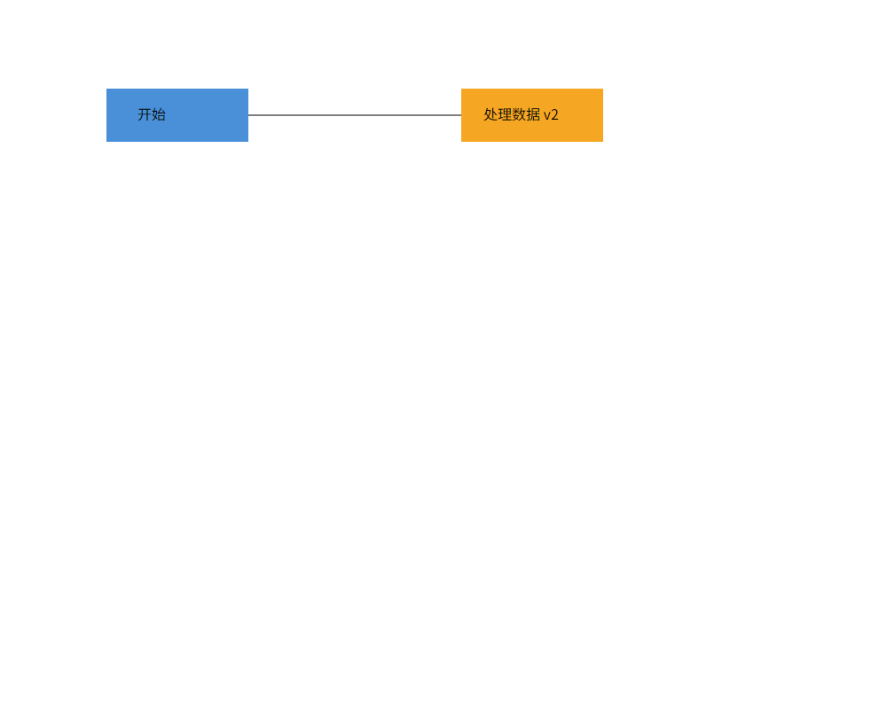
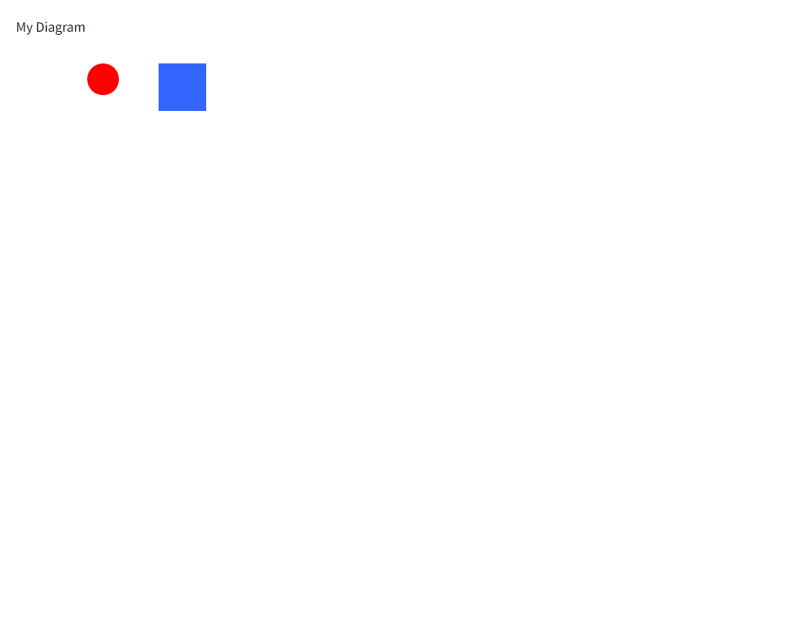

# 最终验收记录

日期：2026-10-30，Asia/Shanghai；用户提供截止日期 2026-10-31。

## 已执行

- 第一部分提交 ab81c87，推送成功。
- 第二部分提交 0fa46d9，第一次推送报 `Recv failure: Connection was reset`，随后重试报 `Failed to connect to github.com port 443`；再次正常推送成功，远程从 ab81c87 快进至 0fa46d9。保留失败记录，不以失败冒充成功。
- 21 文件、393 项测试通过；typecheck 和生产构建通过。最后新增验收文件只含测试，不改变生产构建。
- §6 transcript：两入口输出相同、退出 0，恰有“祖先后代混选”“IO 后禁用 undo”两条预期错误。demo.svg 含 5 元素，圆位置 cx=130、标题撤销还原为 My Diagram、rect 的 ID 为 box（不是 box 类型）。
- §6.1 版本 A：两入口输出相同、退出 0、stderr 空；8 元素，node2 移动时矩形/文字同行，undo 后恢复，保存内容更新为“处理数据 v2”；连接线原位。
- 源码静态检查：58 个 TS 源文件，46 个类一类一文件同名；依赖方向符合约定；唯一 switch 是公共属性白名单。检索确认无 JSON 克隆、无 XML/显示重复六类型分派。
- 作业原文 SHA-256：`D8BBF9409A9596035F13AE809888C64E813EA76966B649911536DA44EABC7F76`，与基线相同。

## 浏览器渲染与图片检查

原生 Computer Use 报 native pipe unavailable，浏览器工具报 access host unavailable；用户随后明确允许无头渲染。使用已安装的 Edge 156.0.4314.50，独立 `.tools/svg-preview-profile`，通过 `--headless --screenshot` 打开真实的本地 SVG 文件，1000×800 视口，两次退出码均为 0。没有修改用户浏览器配置、登录或安全设置。

实际查看截图确认：蓝色“开始”节点与橙色“处理数据 v2”节点同高，文字位于各自矩形内，连接线从左矩形右缘连接到右矩形左缘；demo 为 My Diagram 标题、cx=130 的红圆、蓝色矩形。没有乱码、缺字或 XML 错误页。这是 AI 对真实浏览器截图的查看，不是用户人工交互验收或教师确认。

## 最终复验

`npm ci` 成功（当时 npm audit 为 0 vulnerabilities），之后 typecheck、21 文件/393 项测试、build 全部通过。实际 `npm run cli` 回放 init/create/save/canvas/read/show，退出 0、stderr 空、中文原值正确，EOF 正常结束。

PlantUML 语法检查、SVG/PNG 渲染成功，图片已查看。最终脚本核对 10 份 Markdown 的 45 个本地文件链接，目标全部存在（不含锚点检查）；109 个稳定需求编号无重复，状态为 108 已验证、1 未实现（仅提交后的 final 标签）。package.json 与锁文件依赖/engines 声明一致，git diff --check 通过。远程检查确认 main 为 0fa46d9，尚无 final 标签，避免覆盖旧标签。

最终提交本身及 final 标签只能在本文件提交后产生：提交前矩阵中的 DEL-002 保留未实现状态。Git 交付完成后，以远程 `main`、`refs/tags/final` 及交付回复的真实核验结果为准，不在提交前伪造尚未发生的成功。标签不会提前打在第二部分提交上，也不会重写历史或强制推送。
